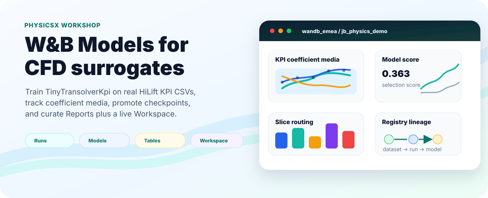
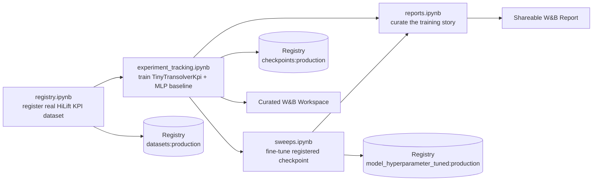
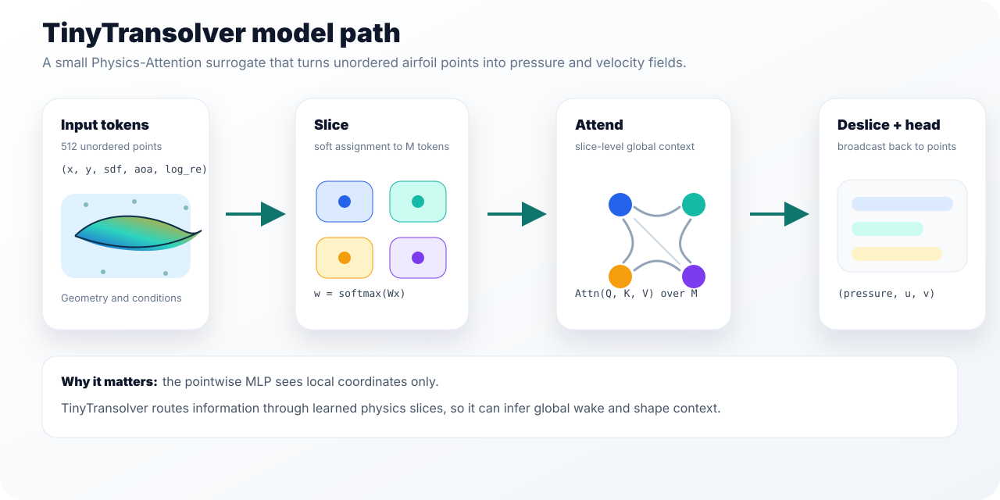
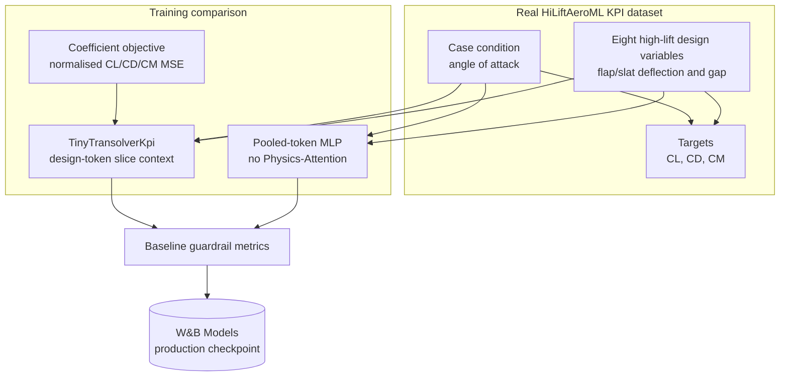
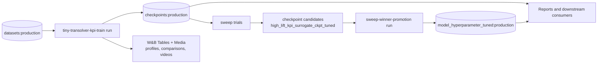

# PhysicsX W&B Workshop

Hands-on demo notebooks for a 2.5-hour Weights & Biases workshop
tailored to PhysicsX's real-data CFD surrogate workflow. Everything
attendees need lives in `notebooks/` and `src/physicsx_demo/utils/`:
the notebooks are thin orchestration layers, the shared code is
importable, and the full flow runs on a laptop CPU against a small
`TinyTransolverKpi` model trained on the public HiLiftAeroML KPI CSVs.
The workshop use case is integrated coefficient prediction for NASA
CRM-HL high-lift variants: eight flap/slat design variables plus angle
of attack in, `cl`, `cd`, and `cm` out.

**Target W&B project:** `wandb_emea/jb_physics_demo`
**Registry entry point:** `wandb-registry-high_lift_surrogates`



## Quickstart

```bash
uv sync --python 3.11      # matches .python-version; installs wandb, torch, matplotlib, ...
uv run wandb login
uv run jupyter lab
```

Then open the notebooks in the order below.

Before presenting, run the remote preflight:

```bash
uv run python scripts/audit_workshop.py
```

## The notebooks — run in this order



| # | Notebook | W&B capability | What it does |
| - | -------- | -------------- | ------------ |
| 1 | `notebooks/registry.ipynb` | **Registry (datasets)** | Promotes the real HiLiftAeroML KPI CSV bundle to `wandb-registry-high_lift_surrogates/datasets:production`. |
| 2 | `notebooks/experiment_tracking.ipynb` | **Runs, artifacts, Tables, media, Workspace** | Pulls the real KPI dataset from the Registry, trains `TinyTransolverKpi`, compares it with a pooled-token MLP baseline, logs coefficient RMSE and prediction media, promotes the best checkpoint to `wandb-registry-high_lift_surrogates/checkpoints:production`, and saves a curated W&B Workspace. |
| 3 | `notebooks/sweeps.ipynb` | **Sweeps + Models Registry** | Loads `checkpoints:production`, runs an 8-trial Bayesian sweep over `lr`, `weight_decay`, and `batch_size`, optimizes `val/selection_score`, logs every trial checkpoint as a model artifact candidate, then links the winning checkpoint into `wandb-registry-high_lift_surrogates/model_hyperparameter_tuned:production`. |
| 4 | `notebooks/reports.ipynb` | **Reports API** | Programmatically generates a shareable Report over the training run's metrics and media panels using `wandb_workspaces.reports.v2`. |

Every notebook uses `with wandb.init(...) as run:` context managers, so
runs finish cleanly on cell exit. Running notebooks out of sequence
raises a clear "artifact not found" — the pipeline is intentionally
strict about ordering.

## Model + dataset





- **Real KPI model.** `TinyTransolverKpi` uses the same Physics-Attention
  blocks on eight HiLiftAeroML design-variable tokens: inboard/outboard
  flap deflection, flap gap, slat deflection, and slat gap. Angle of
  attack is broadcast as a condition, and the pooled output predicts
  `cl`, `cd`, and `cm`. Splits are grouped by `GeoID`, so validation and
  test rows come from held-out aircraft variants rather than shuffled
  angles from already-seen geometries. The training notebook logs
  physical RMSE for each coefficient, drag polar media, prediction
  tables, a pooled-token MLP baseline, and a best-checkpoint Registry
  promotion.
- **Legacy point-field helpers.** The repo still includes a downscaled
  `TinyTransolver` and synthetic CRM-HL-style point-field generator for
  local experiments that need pressure/velocity media without
  downloading large VTU files. These helpers are not the main workshop
  path; `TinyTransolverKpi` and the HiLiftAeroML CSV summaries are.
  Full description of the Physics-Attention mechanism is in
  `docs/explainers/pxtransolver.md`.

## Docs and explainers

- `docs/explainers/pxtransolver.md` — Physics-Attention (slice →
  attend → deslice) mechanism with a full parameter budget and the
  reasoning behind the sizing.
- `docs/explainers/cfd_surrogate_models.md` — introduction to
  neural-field CFD surrogates, the three families
  (surrogate/PINN/operator), and where Transolver sits.
- `docs/explainers/further_reading.md` — curated reading path from
  reviews to foundational papers to modern work, plus a suggested
  six-week schedule.

## Code layout

The notebooks are intentionally thin orchestration layers. Reusable
workshop code lives under `src/physicsx_demo/utils/`:

- `data.py` — `HighLiftCase`, synthetic CRM-HL dataset generation,
  JSON payload helpers, train/val splitting, tensor stacking for the
  optional point-field companion path.
- `hilift_kpi.py` — real HiLiftAeroML KPI CSV loading, geometry-held-out
  splits, normalization, and geometry-token datasets for `cl/cd/cm`.
- `model.py` — `PhysicsAttention`, `TinyTransolverKpi`, KPI token
  baseline, plus legacy point-field models.
- `kpi_training.py` — the real HiLift KPI experiment-tracking training
  routine with W&B Tables, profile media, comparison plots, videos,
  artifacts, Workspace creation, and Registry promotion.
- `metrics.py` — relative L2, slice regularisation diagnostics, and
  legacy point-field pressure-force proxies.
- `viz.py` — high-lift sections, comparison/error plots, scorecards,
  slice assignment frames, W&B-ready image/video helpers.
- `training.py` — legacy point-field training routine retained for
  compact pressure/velocity experiments.

## Dependencies

Runtime dependencies (from `pyproject.toml`):

- `wandb>=0.18`, `wandb-workspaces>=0.2`
- `torch>=2.4`, `numpy>=1.26`, `scikit-learn>=1.4`
- `matplotlib>=3.8`, `pandas>=2.2`, `pyyaml>=6.0`
- `ipykernel>=7.3`, `nbformat>=5.10`

The notebooks are CPU-friendly by default. Optional extras:

- `[realdata]` — installs Hugging Face download support for a real
  HiLiftAeroML subset from `nvidia/HiLiftAeroML`.
- `[notebooks]` — installs `jupyter` if you'd rather not rely on your
  existing Jupyter install.

Install any extra with `uv sync --extra <name>`.

## Real HiLiftAeroML Slice

The full HiLiftAeroML repository is too large for a live workshop
download, so use the guarded subset helper first:

```bash
uv sync --extra realdata
uv run python scripts/download_hilift_subset.py --include-images
uv run python scripts/download_hilift_subset.py --include-images --execute
```

By default this selects geometry IDs `1-4` at AoA `4,8,12,16,20`,
plus root summary CSVs and split manifests. It does **not** download
the per-run boundary or volume archives unless you explicitly ask for
them; those are tens of GB per run.

Once the root CSVs are local, run the real KPI training preflight:

```bash
uv run python scripts/train_hilift_kpi.py --data-dir data/hiliftaeroml_subset --n-geometries 80 --epochs 80
```

That script follows the Transolver++ tutorial pattern: merge
`force_mom_all.csv` with `geo_values_all.csv`, hold out entire
geometries, encode the eight high-lift design variables as semantic
tokens, and predict `cl`, `cd`, and `cm`. Use it as the real-data
backbone for the workshop.

## Presenter preflight

The main demo should be green before the room sees it:

```bash
uv run python scripts/audit_workshop.py
```

If a sweep trial crashes after producing viable candidates, promote the
best composite-score candidate from the latest sweep batch without
rerunning the whole notebook:

```bash
uv run python scripts/promote_latest_sweep.py
```

Then regenerate `notebooks/reports.ipynb` so the shareable Report is
fresh against the current Registry state.

## What lives in the Registry after a full run

`wandb-registry-high_lift_surrogates` on `wandb_emea`:




- `datasets/hilift_kpi_slice` — aliases `production`, `real-kpi`, `v1`.
  Includes `force_mom_all.csv`, `geo_values_all.csv`, split manifests,
  coefficient preview tables, and lightweight wall-shear preview images.
- `checkpoints/high_lift_kpi_surrogate_ckpt` — best-val version aliased
  `production` + `epoch-N`.
- `model_hyperparameter_tuned/high_lift_kpi_surrogate_ckpt_tuned` —
  the best sweep checkpoint linked by `sweep-winner-promotion`, aliased
  `production`, `sweep-winner`, `sweep-<id>`, and `run-<id>`.
- `baselines/kpi_token_mlp_baseline_ckpt` — created only if the
  baseline beats TinyTransolverKpi on the validation guardrail score.

Downstream consumers (attendees' own code, future notebooks, external
projects) resolve each artifact at
`wandb-registry-high_lift_surrogates/{collection}:production`.

## License

Internal workshop material. Not for redistribution.
