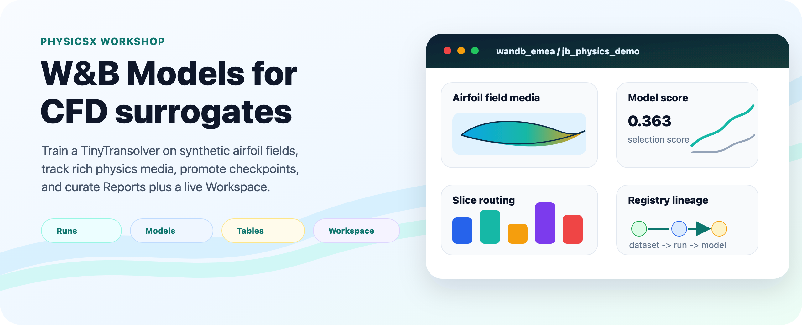
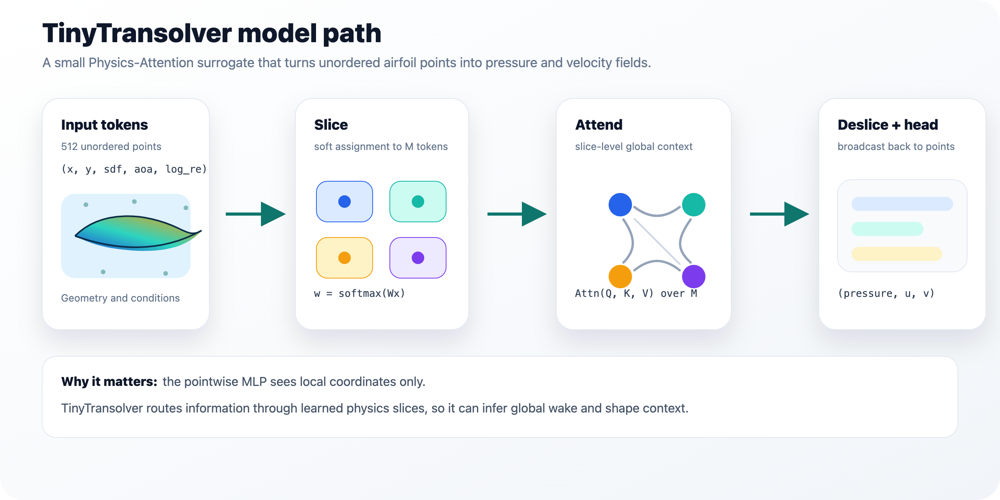
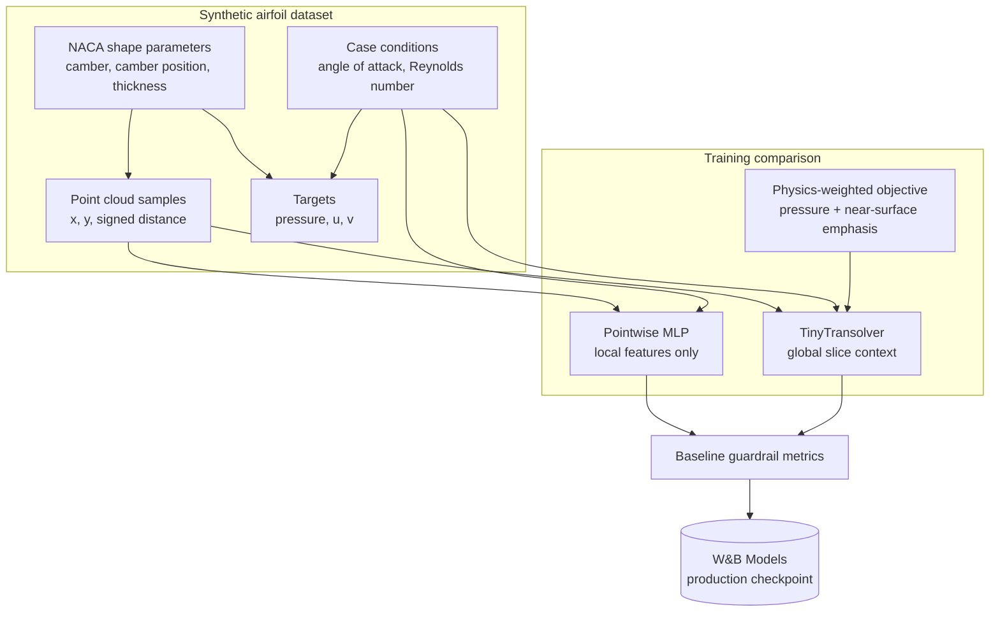
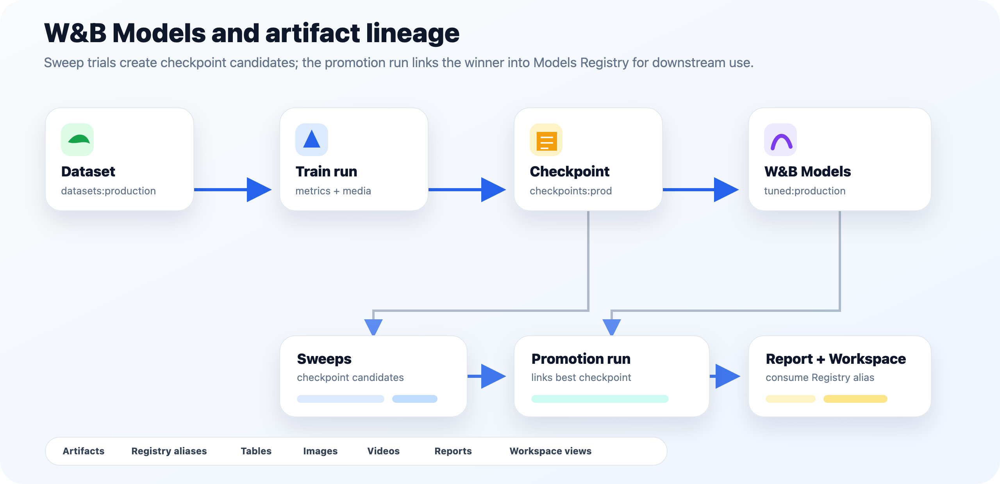
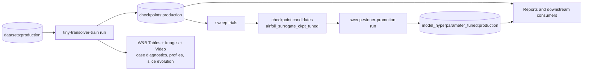

# PhysicsX W&B Workshop

Hands-on demo notebooks for a 2.5-hour Weights & Biases workshop
tailored to PhysicsX's neural-field CFD surrogate workflow. Everything
attendees need lives in `notebooks/` and `src/physicsx_demo/utils/`:
the notebooks are thin orchestration layers, the shared code is
importable, and the full flow runs on a laptop CPU against a small
`TinyTransolver` model trained on synthetic NACA airfoil data.

**Target W&B project:** `wandb_emea/jb_physics_demo`
**Registry entry point:** `wandb-registry-airfoil_surrogates`



## Quickstart

```bash
uv sync --python 3.11      # matches .python-version; installs wandb, torch, matplotlib, ...
uv run wandb login
uv run jupyter lab
```

Then open the notebooks in the order below.

Before presenting, run the remote preflight:

```bash
uv run python scripts/audit_workshop.py
```

## The notebooks — run in this order


| # | Notebook | W&B capability | What it does |
| - | -------- | -------------- | ------------ |
| 1 | `notebooks/registry.ipynb` | **Registry (datasets)** | Generates the synthetic NACA airfoil dataset and promotes it to `wandb-registry-airfoil_surrogates/datasets:production`. |
| 2 | `notebooks/experiment_tracking.ipynb` | **Runs, artifacts, Tables, media, Workspace** | Pulls the dataset from the Registry, trains an ~896k-param global-context `TinyTransolver` for 32 epochs, compares it with a pointwise MLP baseline, logs per-epoch model artifacts, promotes the best checkpoint to `wandb-registry-airfoil_surrogates/checkpoints:production`, and saves the curated four-section W&B Workspace for the live demo. If the baseline wins the composite guardrail score, it is logged and linked separately under `baselines`. |
| 3 | `notebooks/sweeps.ipynb` | **Sweeps + Models Registry** | Loads `checkpoints:production`, runs an 8-trial Bayesian sweep over `lr`, `weight_decay`, `lambda_slice_usage`, `lambda_slice_sharpness`, and `batch_size`, optimizes the composite `val/selection_score`, logs every trial checkpoint as a model artifact candidate, then links the winning checkpoint into `wandb-registry-airfoil_surrogates/model_hyperparameter_tuned:production`. |
| 4 | `notebooks/reports.ipynb` | **Reports API** | Programmatically generates a shareable Report over the training run's metrics and media panels using `wandb_workspaces.reports.v2`. |

Every notebook uses `with wandb.init(...) as run:` context managers, so
runs finish cleanly on cell exit. Running notebooks out of sequence
raises a clear "artifact not found" — the pipeline is intentionally
strict about ordering.

## Model + dataset





- **Model.** A downscaled Transolver — 6 Physics-Attention layers,
  hidden dim 128, 64 slices, a global context path, ~896k parameters. Consumes
  `(x, y, sdf, aoa, log_re)` per point and predicts
  `(pressure, u, v)`. Full description of the Physics-Attention
  mechanism is in `docs/explainers/pxtransolver.md`. The tracking
  notebook trains it with a pressure/channel + near-surface weighted
  MSE, while keeping the pointwise MLP baseline on plain MSE. It also
  logs field-relative-L2, slice-health, lift/drag proxy, and composite
  selection-score metrics for a more honest workshop readout.
- **Dataset.** Synthetic NACA-4-digit airfoils with analytic
  pressure and velocity fields (clipped near singularities), plus a
  hidden global wake/circulation component derived from airfoil shape.
  That hidden component makes the task less trivially pointwise: a
  model with cross-point context can infer it from the full point cloud,
  while a per-point MLP only sees local `(x, y, sdf, aoa, log_re)`.
  80 cases × 512 points, split 80/20 into train/val. Serialised as JSON
  so the payload is self-describing. Each case also carries the hidden
  NACA-style shape parameters used for visualization, so W&B media can
  render clean airfoil silhouettes rather than noisy sample-point
  clouds. The dataset artifact also includes `airfoil_shape_sections`,
  an artifact-backed `wandb.Table` with airfoil profile images and
  chordwise section images for physical inspection.

## Docs and explainers

- `docs/explainers/pxtransolver.md` — Physics-Attention (slice →
  attend → deslice) mechanism with a full parameter budget and the
  reasoning behind the sizing.
- `docs/explainers/cfd_surrogate_models.md` — introduction to
  neural-field CFD surrogates, the three families
  (surrogate/PINN/operator), and where Transolver sits.
- `docs/explainers/further_reading.md` — curated reading path from
  reviews to foundational papers to modern work, plus a suggested
  six-week schedule.

## Code layout

The notebooks are intentionally thin orchestration layers. Reusable
workshop code lives under `src/physicsx_demo/utils/`:

- `data.py` — `AirfoilCase`, synthetic NACA dataset generation,
  JSON payload helpers, train/val splitting, tensor stacking.
- `model.py` — `PhysicsAttention`, `TinyTransolver`, pointwise MLP
  baseline, parameter counting.
- `metrics.py` — relative L2, slice regularisation diagnostics,
  pressure-force proxies, composite selection score.
- `viz.py` — airfoil profiles, comparison/error plots, scorecards,
  slice assignment frames, W&B-ready image/video helpers.
- `training.py` — the full experiment-tracking training routine with
  rich W&B media, Tables, artifacts, and Registry promotion.

## Dependencies

Runtime dependencies (from `pyproject.toml`):

- `wandb>=0.18`, `wandb-workspaces>=0.2`
- `torch>=2.4`, `numpy>=1.26`, `scikit-learn>=1.4`
- `matplotlib>=3.8`, `pandas>=2.2`, `pyyaml>=6.0`
- `ipykernel>=7.3`, `nbformat>=5.10`

The notebooks are CPU-friendly by default. Optional extras:

- `[airfrans]` — the real AirfRANS dataset (Bonnet et al. 2022) if
  you want to swap the synthetic generator.
- `[notebooks]` — installs `jupyter` if you'd rather not rely on your
  existing Jupyter install.

Install any extra with `uv sync --extra <name>`.

## Presenter preflight

The main demo should be green before the room sees it:

```bash
uv run python scripts/audit_workshop.py
```

If a sweep trial crashes after producing viable candidates, promote the
best composite-score candidate from the latest sweep batch without
rerunning the whole notebook:

```bash
uv run python scripts/promote_latest_sweep.py
```

Then regenerate `notebooks/reports.ipynb` so the shareable Report is
fresh against the current Registry state.

## What lives in the Registry after a full run

`wandb-registry-airfoil_surrogates` on `wandb_emea`:





- `datasets/synthetic_airfoil_slice` — aliases `production`, `v1`.
  Includes `synthetic_airfoil_slice.json`, `airfoil_profile_gallery.png`,
  and the `airfoil_shape_sections` media table.
- `checkpoints/airfoil_surrogate_ckpt` — best-val version aliased
  `production` + `epoch-N`.
- `model_hyperparameter_tuned/airfoil_surrogate_ckpt_tuned` —
  the best sweep checkpoint linked by `sweep-winner-promotion`, aliased
  `production`, `sweep-winner`, `sweep-<id>`, and `run-<id>`.
- `baselines/pointwise_mlp_baseline_ckpt` — created only if the
  baseline beats TinyTransolver on the composite guardrail score.

Downstream consumers (attendees' own code, future notebooks, external
projects) resolve each artifact at
`wandb-registry-airfoil_surrogates/{collection}:production`.

## License

Internal workshop material. Not for redistribution.
