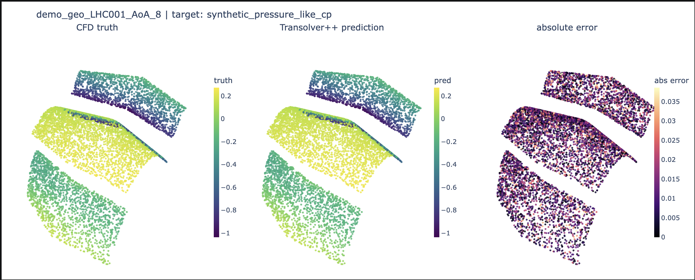
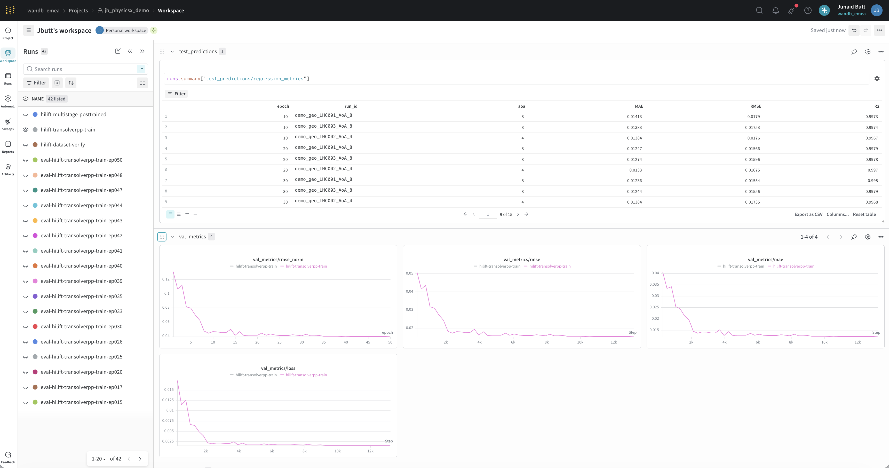
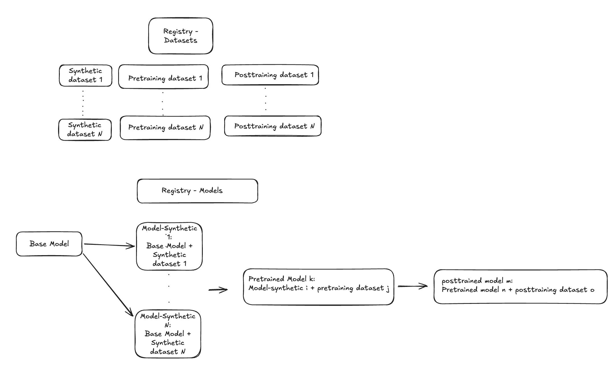
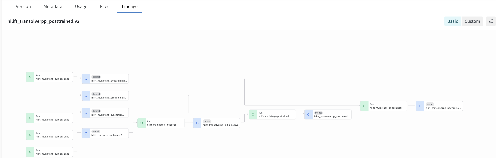

CFD is expensive.

A single Computational Fluid Dynamics (CFD) simulation of a car or a wing takes hours to days on a compute cluster and can produce tens of gigabytes of output. Standard NASA benchmark datasets for these tasks may contain around 13 GB of compressed surface data per case. If you want to explore that design space in any meaningful way, you cannot afford to wait for every configuration to solve.

That's where **surrogate models** come in. A surrogate is a machine-learning model trained on a corpus of CFD results that learns to *approximate* what the solver would predict, but in milliseconds instead of hours. Trained well, it turns an intractable exploration loop into an interactive one. That's the pitch of companies like **physicsX**, who build these surrogates in production for aerospace and automotive customers.

We carried out a workshop with the UK research team at physicsX to demonstrate how the W&B Models platform can support production-ready machine learning workflows. The model we use in this workshop is **Transolver++**, a transformer-style neural network that predicts scalar fields (like the pressure coefficient `Cp`) directly on the point cloud of a wing surface.

However, getting a Transolver++ to train is only half the work. Managing the experiments, tuning the hyperparameters, and handing models between teams, the *engineering* around the science, is the other half. This post is about that other half, and about the tooling we've found makes it tractable, which is **Weights & Biases**.

## The HiLift benchmark

The concrete problem we use throughout the workshop is a **high-lift wing**, the multi-element configuration used at takeoff and landing when a plane needs the most lift at the lowest speed. The NASA **Common Research Model** (CRM) in its High-Lift configuration is a three-element wing (slat, main wing, flap) that the aerospace industry has been benchmarking simulations against for years. Multi-element high-lift devices generate roughly two to three times the lift of a single-element wing at the same speed, which is what makes modern airliners physically able to land at reasonable approach speeds. Any surrogate that claims to be useful for aerospace design has to work on shapes like these.

The dataset behind the workshop is **HiLiftAeroML**, released by NASA in 2026. It contains 1,800 high-fidelity CFD runs across 180 geometry variants of the CRM-HL, sweeping 10 angles of attack per geometry, at roughly 13 GB of compressed surface data per case. This is the scale at which the exploration loop stops being tractable with a raw solver: you cannot re-run 1,800 simulations to explore a new design decision, and you certainly cannot run millions of them to iterate on a customer's geometry. For physicsX, that scale is precisely the point. The CRM-HL exercises every stage of the surrogate-model workflow at industrial fidelity, and if the pattern holds there, it holds for customer geometries too.

## Tracking that captures more than scalars

The conventional training loop prints `val_loss` to stdout each epoch, and you inspect the numbers as they scroll past. With slightly more discipline, you might export to a CSV and plot afterwards in a notebook.

That works for one person, one model, one dataset. It falls apart the moment you have five engineers, three architectures, a dozen ablations, and a customer asking three months later "which run produced this?"

**Weights & Biases (W&B)** is a hosted experiment-tracking service that solves this problem. Every training run gets a URL. Every metric, every hyperparameter, every checkpoint you produce lives at that URL, searchable and comparable across the whole project. In your training script, you call `wandb.init()` at the start and `wandb.log({...})` whenever you have something to record.

The interesting part isn't just the scalar loss curve. For a pressure-field surrogate, `val_loss = 0.05` tells you almost nothing about *where* the model is wrong. Is it fine on the main wing but bad on the flap? Fine at 4° angle of attack (AoA) but breaks down at 16°? Aerospace engineers need to *see* the pressure distribution to trust it.

W&B accommodates that trivially. You can log any scalar you can compute, including per-component RMSE, R², or a domain-specific error norm, and each becomes a filterable, comparable panel on the run page. You are not limited to scalars either. Anything you can construct in Python (a Plotly figure, a Matplotlib chart, a video, an image) can be passed into `wandb.log()` and renders as a first-class panel next to your loss curves.

In the workshop's training notebook, every checkpoint logs a **triptych**: the CFD ground truth, the model's prediction, and the absolute error, all rendered on the same point cloud of the wing:

```python
run.log({
    "val_metrics/mae":          val_mae,
    "val_metrics/rmse":         val_rmse,
    "val_plots/predictions_3d": wandb.Plotly(fig_3d),
    "val_plots/predictions_2d": wandb.Image(fig_2d),
}, step=global_step)
```



*The triptych for one held-out geometry at 8° angle of attack. Truth on the left, Transolver++ prediction in the centre, absolute error on the right, all painted directly onto the wing surface. What an aerodynamicist reads from this image is not a single number: the large-scale pressure recovery on the main wing is correct, the biggest errors are concentrated near the flap gap, and the slat leading edge shows no obvious pathology. That is a qualitative judgement a scalar RMSE will never make for you.*

Five lines of code, and you've turned "model got better" into "model got better *and here's the pressure field it now predicts on this wing at 8° AoA*". A physicsX engineer can spot in seconds whether the wingtip vortex or the flap-slat gap has been captured correctly.

The same primitive scales further. The workshop also builds a **`wandb.Table`**, a structured, sortable data view, of per-case metrics across the full training trajectory. It is populated by resuming the finished training run and iterating every cadence checkpoint, so the result is a single URL where you can inspect every held-out geometry at every saved epoch, sorted by whichever metric matters.



*A snapshot of the training project's workspace. The runs list on the left holds every training and evaluation run. The table at the top right is the `wandb.Table` view of per-case test metrics, built during the resumed run. Below it, four val_metrics panels (norm loss, RMSE, MAE, raw loss) overlay every run so you can compare training curves against evaluation runs side by side. Every one of those panels was produced by a `wandb.log` call, not by wiring up a separate dashboarding tool.*

For an ML team producing models other engineers have to trust, this visual richness is not a nice-to-have. It is the difference between "the loss went down" and "we can defend this to a customer."

## Parallel hyperparameter search with Sweeps

Once you have a model that trains, the next question is *how well can we tune it?* Fine-tuning a Transolver++ has at least four dials worth touching: learning rate, weight decay, dropout, and batch size. Each is a continuous or wide-discrete range. Grid search over reasonable ranges runs into hundreds of trials. Manual guessing wastes both engineer-hours and GPU-hours.

W&B's answer is **Sweeps**. A sweep is a controller service on W&B's side that proposes hyperparameter trials, distributes them to any number of agent processes you spin up, and centralises the results in one project view.

The workshop uses **Bayesian** search rather than grid or random. Bayesian search fits a probabilistic model of "which hyperparameters produce good losses" as trials complete, and preferentially samples from promising regions. On a small budget of 8 trials, the workshop's cap (chosen to keep the demo runnable on a laptop), Bayesian search converges appreciably faster than grid or random on a comparable budget.

The config for a sweep is a single Python dict:

```python
SWEEP_CONFIG = {
    "method":  "bayes",
    "metric":  {"name": "val_metrics/loss", "goal": "minimize"},
    "parameters": {
        "lr":           {"distribution": "log_uniform_values", "min": 1e-5, "max": 3e-3},
        "weight_decay": {"distribution": "log_uniform_values", "min": 1e-6, "max": 1e-3},
        "dropout":      {"distribution": "uniform",            "min": 0.0,  "max": 0.15},
        "batch_size":   {"values": [4, 8]},
    },
}
```

Register that with `wandb.sweep(SWEEP_CONFIG, ...)` and it returns a `sweep_id`. Then `wandb.agent(sweep_id, function=train_fn, count=8)` runs eight trials in the current process.

Here is the payoff, and it is the one that matters most for a physicsX-style setup. **That `sweep_id` is shared across agents.** You can start eight `wandb.agent(sweep_id, ...)` processes on eight machines, or across a Kubernetes cluster with 80 GPUs, and each one independently pulls the next trial from the controller. There is no coordination code, no message-passing, and no distributed state. Adding compute doesn't add complexity; it just makes the sweep finish sooner.

Every CFD-surrogate trial is a real training job that eats real GPU-time. Bayesian search cuts the number of trials you need without cutting coverage of the interesting regions. Parallelism means the whole search finishes in wall-clock hours instead of days. Together they are the difference between "we can afford to tune this properly" and "we ship the first thing that works."

When the sweep finishes, W&B automatically builds two panels worth calling out. The **parallel-coordinates plot** shows each trial as a line across every hyperparameter axis, coloured by objective, letting you visually spot the good region at a glance. The **parameter importance** chart tells you which hyperparameters actually mattered for this problem. Both come for free; both make the difference between running a sweep and *learning* from a sweep.

## Multi-team pipelines with the Registry

A production ML team is rarely one person tuning one model. Multiple teams contribute, in sequence, over months. One team owns the base architecture and the normalisation contract. Another handles broad-domain pretraining across whatever CFD data is available in-house. A third fine-tunes to the regime a specific customer cares about, such as high angle-of-attack and near-stall behaviour.

Absent proper tooling, this collapses to a shared filesystem, ad-hoc Slack threads, and the recurring question "which `.pt` file was that again?" It does not scale.

W&B's answer is the **Registry**. Think of it as a versioned, per-organisation store for **artifacts**, a W&B term for versioned files or file-sets, typically a model checkpoint or a dataset. Any team can publish an artifact into a **Collection** (a named bucket, like `pretrained` or `posttrained`), and downstream teams consume it by a stable **alias**, most often `production`. The producer knows their code; the consumer knows an alias. Nobody has to know the other team's file paths.

The workshop demonstrates this with a three-stage pipeline, each stage authored as if a different team owned it:

- The **init team** derives normalisation statistics from a synthetic dataset, fits a baseline, and promotes the result to `initialised:production`.
- The **pretraining team** consumes `initialised:production`, broadens to three geometries across low and mid angles of attack, and promotes to `pretrained:production`.
- The **posttraining team** consumes `pretrained:production`, fine-tunes on the near-stall regime the deployment customer actually cares about, and promotes to `posttrained:production`.



*The pipeline in one picture. The top row is the Dataset Registry, split into synthetic, pretraining, and posttraining collections. The bottom row is the Model Registry: the base model fans out to many `Model-Synthetic` variants, one of which becomes the input to the pretraining stage, whose output becomes the input to posttraining. Each arrow is a `use_artifact` edge, and each collection is versioned with a stable `production` alias that downstream teams pin to. Different teams can iterate independently along the top row (curating datasets) and the bottom row (training models) without ever having to coordinate a file path.*

Each stage runs as its own `wandb.init(...)`, with no cross-run resume and no concurrent-writer bugs. The Registry is the *only* communication surface between teams. The whole handoff is two lines inside each training block:

```python
with wandb.init(entity=ENTITY, project=PROJECT, job_type="train-stage") as run:
    src = run.use_artifact(
        "wandb-registry-hilift_multistage_models/pretrained:production",
        type="model",
    )
    # ... train ...
    run.link_artifact(
        out_artifact,
        target_path="wandb-registry-hilift_multistage_models/posttrained",
        aliases=["production", "v1"],
    )
```

That single pair of calls does something quietly important: it records **lineage**. W&B knows which run produced each artifact, and which artifacts each run consumed. A single query then walks the entire graph. Ask "which dataset trained the model our customer is running?" and the answer traces `posttrained → pretrained → initialised → base`, along with the exact dataset artifact consumed at each stage. That is not a spreadsheet somebody has to keep up to date; it is a live property of the system.



*The Lineage tab in the W&B UI for the final `hilift_transolverpp_posttrained:v2` artifact. Reading right-to-left, each blue diamond is a model artifact and each green box is the run that produced it. The chain walks posttrained → pretrained → initialised → base, and every stage's dataset artifact is attached directly to the run that consumed it. Provenance and dataset lineage are answered by a single graph.*

The payoff is more than tidiness. Staged pretraining plus a small task-specific fine-tune dramatically reduces the total high-fidelity data needed to hit a target accuracy: around 500 pretraining samples plus 50 task-specific samples, versus roughly 50,000 samples from scratch (per the workshop's underlying references). The Registry is what makes that staging manageable across teams.

Two smaller Registry features are worth naming. **Collection cards** are markdown documentation that lives with the artifact, versioned with your code, re-synced idempotently on every re-run, so downstream consumers know what they're pulling without having to ask. **Aliases are cheap to move**: rolling back a bad model is a one-line change to point `production` at a prior version, with no code deploy.

For regulated aerospace applications, this level of auditability is not optional. When a customer asks *why* the model behaves a certain way, the lineage graph *is* the answer.

## Bringing it all together

Three primitives, one arc: *track everything visually → search efficiently → hand off cleanly.*

Physics-ML is not a Kaggle notebook. It is a long-running, multi-team, multi-stage engineering discipline where the model has to look right (not just score well), where each experiment costs real compute, and where the answer to "why did the model do that?" has to be traceable months later. The tooling has to match. The workshop this post is about, a sequence of notebooks in the `physicsx_demo` repo, walks through the whole pattern end-to-end using nothing more than the standard W&B primitives shown here.

If you are building CFD surrogates, or any physics-ML workflow with more than one person in the loop, these patterns generalise cleanly. Fork the repo, point it at your own W&B project, and see for yourself.
