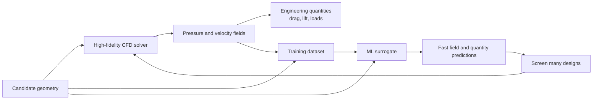
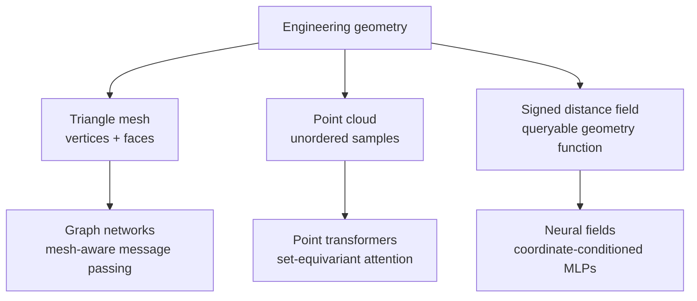
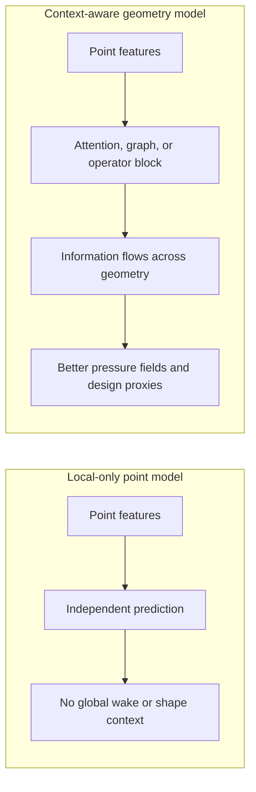

# Lecture Notes — ML Surrogates for Computational Fluid Dynamics

**Audience.** ML beginners who have trained (or seen someone train) an
image classifier or a small tabular regressor, and now want to
understand the kinds of models PhysicsX and adjacent teams build.

**Prerequisites.** Linear algebra at the level of matrix-vector
products, basic calculus (partial derivatives and the chain rule),
and comfort with Python. No prior fluid-dynamics knowledge assumed.

**How to read.** These are lecture notes, not a textbook. Definitions,
worked examples, and remarks are set off explicitly. Every lecture has
one or two by-hand examples — do the arithmetic yourself, don't just
read past it. Exercises live at the end of each lecture; a small set
of pointer exercises appears in section 9. For pointers into the
research literature, see the companion `further_reading.md`.

---

## Lecture 1 — The physical problem: what CFD does and why it is slow

### 1.1 Fluids and fields

A **fluid** is a substance that flows: air, water, exhaust gas. To
describe how a fluid moves through a region of space, physicists use
**fields** — functions that assign a value to every point in that
region. The two most important are:

- **Velocity field** `u(x, y, z, t)`. At every point in space, at every
  moment in time, gives the vector velocity of the fluid — a 3-tuple
  `(u, v, w)` telling you how fast fluid is moving and in which
  direction.
- **Pressure field** `p(x, y, z, t)`. At every point, gives the scalar
  fluid pressure.

> **Definition (field).** A *field* is a function whose input is a
> point in space (and sometimes time) and whose output is a value
> — scalar (one number), vector (a small tuple), or tensor (a small
> matrix). "Predicting a field" means predicting that function, not
> a single number.

The engineering questions that CFD answers are always questions
about these fields. "What is the drag on this car body?" is a
question about the pressure field on the surface of the car.
"Where does flow separate from the roof?" is a question about
where the velocity field near the surface reverses.

### 1.2 The Navier-Stokes equations at a glance

The velocity and pressure fields are governed by the **Navier-Stokes
equations**, a system of partial differential equations (PDEs). In
their incompressible form:

```
∂u/∂t + (u · ∇) u = − (1/ρ) ∇p + ν ∇²u        (momentum)
∇ · u = 0                                     (mass conservation)
```

You will not need to solve these by hand. What matters for these notes
is:

1. They are **PDEs** — they relate derivatives of the fields to each
   other in space and time.
2. They are **non-linear** (the `(u · ∇) u` term multiplies the field
   by its own gradient) — which is why turbulence exists and why
   analytic solutions almost never do.
3. Solving them numerically means discretising space and time and
   iterating.

### 1.3 Discretisation: meshes and cells

A computer cannot represent a continuous field. It represents the
field by its values at a **finite set of points**. Those points are
the vertices of a **mesh** — a partition of the region around the
object into small cells (typically tetrahedra in 3D or triangles in
2D). The solver keeps a value of `p`, `u`, `v`, `w` at each mesh
vertex (or cell centre), and updates them in lock-step according to a
discretised version of Navier-Stokes.

The finer the mesh, the more faithful the discretisation. But finer
means more cells, and more cells means more compute.

### 1.4 Worked example — the cost of resolving a car body

Consider a 5 m × 2 m × 1.5 m box around a car. To capture the flow
near the surface, we want cells about 1 mm on a side in the region
close to the car. The total number of 1 mm cells needed to fill even
just a thin 5 cm boundary layer around the car surface is:

- Car surface area ≈ 15 m² (order of magnitude).
- Boundary-layer thickness ≈ 5 cm = 0.05 m.
- Volume of the boundary layer ≈ 15 × 0.05 = 0.75 m³.
- Cell volume at 1 mm = (10⁻³ m)³ = 10⁻⁹ m³.
- Cells in the boundary layer alone: 0.75 / 10⁻⁹ = **7.5 × 10⁸ cells**.

That's nearly a billion cells for just the boundary layer. The rest
of the domain adds tens of millions more.

Each Navier-Stokes iteration needs to visit every cell. If each cell
takes 1 microsecond to update, one iteration takes 750 seconds ≈
12 minutes. Simulations typically need thousands of iterations to
converge. That is why a "small" CFD run on a car takes hours to
days on a compute cluster.

> **Remark.** The 1 billion cells figure is not an artefact of picking
> pessimistic numbers. Production automotive CFD meshes routinely sit
> in the 100 million to 1 billion cell range. This is the wall the
> surrogate model is trying to climb over.

### 1.5 The surrogate idea

The observation that turns this into an ML problem: engineers rarely
want *the whole solution to Navier-Stokes*. They want a very small
number of derived quantities — drag, lift, a few pressure profiles —
for each of many candidate designs. If we can train a model that maps
`geometry → derived quantities` (or `geometry → surface field`)
directly, we avoid solving the PDE every time.



> **Definition (surrogate model).** A learned function
> `f_θ : geometry → field` (or `geometry → scalar summary`) trained
> to imitate the output of a full CFD solver. It replaces the
> expensive physical simulation at inference time.

The word *surrogate* is intentional: the trained model stands in for
the true physics only where its training data covered.

### Exercises 1

1. Estimate the number of cells needed to resolve a 2 m × 2 m × 2 m
   box at 5 mm resolution uniformly. (Answer: 6.4 × 10⁷.)
2. If a training run for a surrogate takes 10 hours on a GPU and each
   inference takes 5 seconds, how many CFD solves (each 6 hours)
   does the surrogate need to replace before it pays for its training
   time? Assume you eventually run 500 designs.

---

## Lecture 2 — Supervised learning: a compact primer

Before we look at what makes CFD surrogates unusual, let's fix
notation for the vanilla case.

### 2.1 The `(X, y)` view

Supervised learning starts from a **dataset**
`D = {(X⁽¹⁾, y⁽¹⁾), (X⁽²⁾, y⁽²⁾), …, (X⁽ᴺ⁾, y⁽ᴺ⁾)}` of `N` input-output
pairs. Every `X⁽ⁿ⁾` has the same shape; every `y⁽ⁿ⁾` has the same
shape. For an image classifier, `X⁽ⁿ⁾ ∈ ℝ²²⁴ˣ²²⁴ˣ³` and `y⁽ⁿ⁾ ∈
{0, 1, …, 999}`.

### 2.2 Model, loss, gradient descent

A **model** is a parameterised function `f_θ` with tunable weights
`θ`. A **loss function** `L(y_pred, y_true)` measures how wrong a
prediction is. Training solves the optimisation

```
θ* = argmin_θ  (1/N) Σ_n  L( f_θ(X⁽ⁿ⁾), y⁽ⁿ⁾ )
```

by repeatedly nudging `θ` in the direction that decreases the loss:

```
θ ← θ − η · ∇_θ L
```

where `η` is the learning rate.

### 2.3 Worked example — fit a line by hand

Suppose we want to fit `y = a x + b` to two points `(1, 3)` and `(2, 5)`.
The parameters are `θ = (a, b)`. Loss on the two points, with
`f_θ(x) = a x + b`:

```
L(a, b) = ((a·1 + b) − 3)² + ((a·2 + b) − 5)²
```

Take partial derivatives (this is one gradient computation any ML
engineer should have done at least once):

```
∂L/∂a = 2·((a + b) − 3)·1 + 2·((2a + b) − 5)·2
∂L/∂b = 2·((a + b) − 3)   + 2·((2a + b) − 5)
```

Start with `a = 0, b = 0`. Then:
- `(a + b) − 3 = −3`
- `(2a + b) − 5 = −5`
- `∂L/∂a = 2·(−3)·1 + 2·(−5)·2 = −6 − 20 = −26`
- `∂L/∂b = 2·(−3) + 2·(−5) = −6 − 10 = −16`

One gradient step with `η = 0.05`:

```
a ← 0 − 0.05·(−26) =  1.30
b ← 0 − 0.05·(−16) =  0.80
```

New loss: `((1.30 + 0.80) − 3)² + ((2·1.30 + 0.80) − 5)²`
`= (−0.90)² + (−1.60)²`
`= 0.81 + 2.56 = 3.37`.

Original loss with `a = b = 0` was `9 + 25 = 34`. One step reduced the
loss ten-fold. This is gradient descent in miniature. Everything that
follows is a more elaborate `f_θ` and a more elaborate loss, but the
optimisation shape is the same.

### 2.4 Notation for the rest of the notes

- `x ∈ ℝᵈ` — an input point in space (`d = 3` for 3D CFD).
- `y` — the target field value at that point (a scalar or a small
  vector like `(p, u, v, w)`).
- `g` — the geometry of the object being simulated. Represented as a
  point cloud, a mesh, or a signed-distance function.
- `θ` — network parameters. We'll write `f_θ(x; g)` for a network that
  predicts the field at `x` given geometry `g`.

### Exercises 2

1. Take one more gradient step in the worked example above and report
   the new loss.
2. Show that if `L(a, b)` is convex in `(a, b)`, then with a small
   enough `η` gradient descent converges to the unique minimum.
   (Sketch: expand `L(θ − η∇L)` to second order.)

---

## Lecture 3 — Where the classifier recipe breaks

Three assumptions from Lecture 2 fail for CFD.

### 3.1 Variable-size geometric input

A car body is a *shape*, not a fixed-size array. Common
representations:



- **Triangle mesh.** A list of vertices and triangles. Different cars
  have different vertex counts.
- **Point cloud.** A bag of `k` points sampled from the car surface,
  each with a 3D position and optional local features (curvature,
  surface normal). `k` is chosen by the modeller, but the *ordering*
  of the points has no meaning.
- **Signed distance function (SDF).** At every point in 3D space,
  the value of a function that returns "how far to the nearest
  surface, negative if inside".

None of these is a `224 × 224 × 3` tensor. A plain CNN — which assumes
a rigid grid — cannot consume them. We need architectures that handle
variable-size, permutation-invariant, geometric input.

### 3.2 Field-valued output

A classifier outputs one label per input. A CFD surrogate should
output *millions* of values per input: the pressure and velocity at
every mesh point. Two ways to handle that:

- **Bulk prediction.** Predict a fixed-size grid of field values in
  one forward pass. Simple, but the output shape is tied to a
  specific mesh resolution.
- **Point-wise prediction.** Predict *one point at a time*. The model
  takes a query location `x` as input; at inference time, evaluate it
  at as many points as you want. This is the **neural-field**
  approach and it dominates modern work (Lecture 4).

### 3.3 The small-data, huge-samples regime

ImageNet has `N ≈ 1.2 × 10⁶` samples, each `~150 KB`. A production CFD
dataset might have `N ≈ 10³` samples, each `~5 GB`. The total dataset
size is similar (a few TB) but the shape of the problem is inverted:

|                         | ImageNet         | CFD dataset      |
| ----------------------- | ---------------- | ---------------- |
| Samples `N`             | 1.2 million      | ~1 000           |
| Bytes per sample        | 150 kB           | 5 GB             |
| Signal per sample       | one label bit    | 10⁸ field values |
| Cost of one new sample  | seconds (label)  | hours (solve)    |

Every ML intuition trained on ImageNet-style data — "more data beats
smarter models", "use lots of aggressive augmentation", "throw
gradient at it" — bends when you flip these numbers. Multi-stage
training (Lecture 6) is a direct consequence.

### Exercises 3

1. Suggest a "geometric augmentation" — a transformation of the input
   geometry that produces a new valid training example — analogous
   to random crop for images. What are the physical constraints your
   augmentation must respect? (Rotating the car around its vertical
   axis is a good starting example; think about what changes.)
2. Give one advantage of point-wise field prediction beyond
   resolution flexibility.

---

## Lecture 4 — Neural fields

### 4.1 Representing a function with a neural network

A **neural field** is a small neural network trained to represent a
function. Concretely, an MLP `f_θ : ℝᵈ → ℝᵐ` that takes a coordinate
`x` in the input space and returns a value at that coordinate.

> **Definition (neural field).** A neural network `f_θ` whose input is
> a coordinate `x` and whose output is a field value at `x`. Training
> minimises the loss `L(f_θ(x), y_true(x))` over sampled coordinates
> `x`.

Analogy: instead of storing a pixel image as an `H × W × 3` tensor,
imagine storing it as an MLP that maps `(u, v) → (r, g, b)`. To
render the image at resolution `H × W`, evaluate the MLP at `H · W`
coordinates. To render at 4× resolution, evaluate at 16 · H · W
coordinates — no retraining. That flexibility is why neural fields
matter.

### 4.2 The plain MLP as a coordinate-to-value map

The simplest neural field is a small MLP. Sketch of a 2-layer
version:

```
x  ──►  h₁ = σ(W₁ x + b₁)  ──►  h₂ = σ(W₂ h₁ + b₂)  ──►  y = W₃ h₂ + b₃
```

`W₁, W₂, W₃, b₁, b₂, b₃` are the trainable parameters. `σ` is a
non-linear activation (`ReLU`, `tanh`, or sine for a SIREN).

### 4.3 Worked example — hand-computing a tiny MLP forward pass

Let's compute one forward pass of a 1D neural field. We want the
field `f(x) = x²` and we'll evaluate a randomly-initialised network
at `x = 0.5`.

Network:
- Input: `x = 0.5` (1D).
- Hidden layer: 2 neurons, `ReLU` activation.
- Output: 1 neuron, linear.

Weights (chosen for arithmetic simplicity):

```
W₁ = [ 1.0 ,  −0.5 ]ᵀ    b₁ = [ 0.0, 0.2 ]ᵀ
W₂ = [ 0.4 ,   0.6 ]     b₂ = 0.1
```

Forward pass:

1. Pre-activation of hidden layer:
   `z₁ = W₁ · x + b₁`
   `   = [1.0·0.5, −0.5·0.5]ᵀ + [0.0, 0.2]ᵀ`
   `   = [0.5, −0.05]ᵀ`
2. Apply ReLU (`max(0, z)`):
   `h₁ = [0.5, 0.0]ᵀ`
3. Output layer:
   `y = W₂ · h₁ + b₂ = 0.4·0.5 + 0.6·0.0 + 0.1 = 0.30`

The network predicts `0.30`. The true target is `0.5² = 0.25`. Loss
(squared error) is `(0.30 − 0.25)² = 0.0025`. Gradient descent would
now nudge `W₁, W₂, b₁, b₂` to shrink that. Repeat for many `x` values
sampled from the interval, and the network learns to approximate `x²`
everywhere in that interval.

That is a neural field for the 1D function `f(x) = x²`. Everything
after this is bigger networks, higher dimensions, and cleverer inputs.

### 4.4 Conditioning: making the field depend on geometry

A plain MLP that only sees `x` can only represent *one* field. That's
useless as a surrogate; we want the field to depend on the input
geometry `g`. The fix is to concatenate an *encoding* of the geometry
to the coordinate:

```
y = f_θ(x, e(g))
```

where `e(g) ∈ ℝᵏ` is a learned embedding of the geometry — a fixed
`k`-dimensional vector that summarises the shape of the car. The
same MLP now represents *many* fields, one per geometry.

Where does `e(g)` come from? An **encoder** network — usually a
transformer that processes the geometry tokens (Lecture 5). At
training time the encoder and the field MLP are trained jointly.

Picture:

```
     geometry g                     query x
          │                            │
          ▼                            │
   ┌───────────────┐                   │
   │  encoder      │                   │
   │  (transformer)│                   │
   └───────────────┘                   │
          │                            │
          ▼                            │
    e(g) ∈ ℝᵏ  ─────► concatenate ◄────┘
                          │
                          ▼
                    ┌──────────┐
                    │  field   │
                    │  MLP     │
                    └──────────┘
                          │
                          ▼
                     f_θ(x, e(g))
```

### 4.5 Positional encoding and why raw coordinates fail

There is one subtlety worth flagging early: a plain MLP fed a raw
coordinate `x ∈ ℝ³` has a strong low-frequency bias. It struggles to
fit sharp field features (pressure spikes near a leading edge, thin
shear layers).

The standard fix is to feed the network a **positional encoding** —
the coordinate mapped through a set of sines and cosines at multiple
frequencies:

```
γ(x) = [ sin(2⁰πx), cos(2⁰πx), sin(2¹πx), cos(2¹πx), …, sin(2ᴸπx), cos(2ᴸπx) ]
```

The network then sees `γ(x)` instead of `x`. This gives it a rich set
of high-frequency basis functions to combine, and dramatically
improves its ability to fit sharp features. This trick is one of the
central innovations that made neural fields practical; the reference
is Tancik et al. (2020).

### Exercises 4

1. In the worked example (4.3), replace ReLU with `tanh` and recompute
   the forward pass. What is the new output?
2. Design a 1D positional encoding with `L = 3` frequencies. Write out
   `γ(0.5)` as a 6-vector.
3. Explain in one sentence why a *conditioned* neural field can
   generalise across geometries, while an *unconditioned* one cannot.

---

## Lecture 5 — Attention and geometry encoders

The encoder that produces `e(g)` is almost always a **transformer**.
This lecture unpacks why, and computes one attention step by hand.



### 5.1 Tokenisation

To feed a variable-size geometry into a transformer, we first
tokenise it. Common choices for CFD:

- **Surface points.** Sample `k` points from the car surface. Each
  point becomes a token of the form `(x, y, z, normal_x, normal_y,
  normal_z, ...)`.
- **Volume patches.** Split the volume around the car into small
  cubic patches; each patch summarises the local SDF into a token.
- **Mesh cells.** Each cell in the CFD mesh is a token.

The set of tokens plays the same role that a sequence of word tokens
plays in a language model — with the important difference that the
tokens are *unordered*. Position information is baked into the token
itself (via the coordinate) rather than into an ordinal index.

### 5.2 Scaled dot-product attention

The core operation of a transformer is **attention**. Given three
matrices `Q, K, V` (each `n × d`, where `n` is the number of tokens
and `d` is a hidden dimension), attention computes:

```
Attention(Q, K, V) = softmax( Q Kᵀ / √d ) · V
```

Read left-to-right:

1. `Q Kᵀ` — a `n × n` matrix of *scores*. Entry `(i, j)` measures how
   much token `i`'s query matches token `j`'s key.
2. Divide by `√d` to keep the scores from blowing up as `d` grows.
3. `softmax` over each row turns the scores into a probability
   distribution — a vector of *attention weights* that sums to 1.
4. Multiply by `V` — a *weighted sum* of the value vectors, weighted
   by attention.

Intuitively: each token gathers information from every other token,
weighted by how relevant they are.

### 5.3 Worked example — attention between three surface points and a query

Let's compute one attention step by hand. We have 3 surface-point
tokens and 1 query "point where we want to predict pressure".

Set the hidden dimension to `d = 2` for arithmetic tractability.

Query (from the query point):    `q  = [1, 0]`
Keys (one per surface token):    `k₁ = [1, 0]`, `k₂ = [0, 1]`, `k₃ = [1, 1]`
Values (also per surface token): `v₁ = [10, 0]`, `v₂ = [0, 10]`, `v₃ = [5, 5]`

Step 1 — scores. Dot the query with each key:

```
q · k₁ = 1·1 + 0·0 = 1
q · k₂ = 1·0 + 0·1 = 0
q · k₃ = 1·1 + 0·1 = 1
```

Step 2 — scale by `√d = √2 ≈ 1.414`:

```
s₁ = 1 / 1.414 = 0.707
s₂ = 0 / 1.414 = 0.000
s₃ = 1 / 1.414 = 0.707
```

Step 3 — softmax. Exponentials:

```
exp(0.707) = 2.028
exp(0.000) = 1.000
exp(0.707) = 2.028
sum = 5.056
```

Weights (normalised):

```
w₁ = 2.028 / 5.056 = 0.401
w₂ = 1.000 / 5.056 = 0.198
w₃ = 2.028 / 5.056 = 0.401
```

Step 4 — weighted sum of values:

```
output = w₁ v₁ + w₂ v₂ + w₃ v₃
       = 0.401·[10, 0] + 0.198·[0, 10] + 0.401·[5, 5]
       = [4.01, 0] + [0, 1.98] + [2.005, 2.005]
       = [6.02, 3.98]
```

That is the attended output for the query. Intuitively, the query
"looked like" surface tokens 1 and 3 (they had matching keys), so it
gathered mostly their values; it ignored surface token 2.

This is the mechanism, in full. Everything that follows in a real
network is:

- Multiple attention heads in parallel, each with its own `Q, K, V`
  projections.
- Stacked layers of attention with feed-forward blocks in between.
- Learned linear projections that produce `Q, K, V` from the raw
  token embeddings.

But every one of the millions of attention calls in a 300M-parameter
transformer is the same four steps you just did by hand.

### 5.4 Encoder + decoder split for CFD

The full surrogate architecture typically has two transformer stacks:

- **Encoder.** Consumes the geometry tokens and produces the
  geometry embedding — a set of latent tokens that summarise the
  shape. Run once per input geometry.
- **Decoder / field head.** Takes the query point and cross-attends to
  the encoder's latent tokens to produce the field value at that
  point. Run once per query location.

Because the decoder is small and the encoder runs once, evaluating
the surrogate at millions of query points is cheap — the expensive
work has already happened in the encoder.

### 5.5 Why ~300M parameters

Two reasons.

1. **Long-range coupling.** In a flow field, disturbances at the front
   of the car affect pressure at the rear. Attention *is* the
   mechanism that lets any point in the field see any other point;
   the more capacity, the richer the couplings the model can encode.
2. **Generality.** A production surrogate has to work across many
   cars, many flow conditions, many operating regimes. Each of those
   axes adds effective dimensions to the input space, and each
   dimension needs enough capacity to memorise the behaviour there.

For comparison: a small language model is ~100M parameters, a
production LLM is 10-100B. A ~300M-parameter physics surrogate is
smaller than any modern language model — but it does a very specific
job on a small dataset, so the parameter-per-training-example ratio
is much higher than in language.

### Exercises 5

1. In the worked attention example (5.3), what would happen to the
   output if `v₂` were changed to `[100, 100]`? Recompute the output.
   Would `v₂`'s change dominate?
2. Multi-head attention runs `H` attention operations in parallel with
   different `Q, K, V` projections and concatenates the results. Give
   one physical reason multi-head is useful for CFD.

---

## Lecture 6 — Multi-stage training

Small `N`, huge samples, expensive labels: this regime rewards
staging the training in phases rather than blasting one big run.

### 6.1 Why one shot doesn't work

Training a 300M-parameter transformer from scratch on 1 000 CFD
samples is a losing proposition. The model has thousands of parameters
per training example — it will memorise the dataset perfectly and
generalise poorly.

The solution is the same idea that made LLMs work: **transfer
learning**. Pretrain on plentiful but cheap data, then fine-tune on
the expensive good data.

### 6.2 Stage 1 — Synthetic pretraining

Use a cheap classical solver to generate a *large* dataset of
low-fidelity examples.

- For airfoils: a **panel method** solves an idealised
  potential-flow model in milliseconds per case. Not physically
  accurate for viscous flow — but it captures the *shape* of the
  problem: how geometry maps to a smooth pressure field.
- For cars: a low-fidelity RANS setup on a coarse mesh, or an
  analytical approximation.
- For general PDEs: any solver that can be run cheaply enough to
  generate `~10⁵ – 10⁶` samples.

The pretrained model isn't accurate on real physics yet, but it has
learned:

- How to embed a variable-size geometry.
- Where attention should focus (leading edges, wake regions, ...).
- A prior over what "smooth field" means.

Analogous to next-token pretraining for language models: generic,
cheap, plentiful.

### 6.3 Stage 2 — High-fidelity pretraining

Fine-tune the Stage 1 model on the real, expensive simulations
(RANS with fine meshes, LES, DNS). These are the ground-truth
examples, but they're scarce (`~1 000` samples).

Because Stage 1 has already handled representation learning, Stage 2
only needs to *correct* the model's physics. It needs far fewer
examples to reach useful accuracy than a from-scratch model would.

Analogous to instruction fine-tuning of a language model: narrow,
expensive, effective.

### 6.4 Stage 3 — Task-specific fine-tuning

For a specific customer, geometry family, or operating regime (racing
car at 300 km/h, near-stall angles of attack), fine-tune again on just
that slice. This is where the model becomes a genuinely useful
engineering tool for the customer's specific problem.

Concretely for the workshop demo: Stage 3 is a fine-tune on
high-angle-of-attack cases only, which sharpens accuracy in the
regime the customer cares about at the cost of general-purpose
performance.

### 6.5 Illustration — the sample-efficiency gain

A schematic of the sample requirement at each stage:

```
Training from scratch on high-fidelity data:
     samples needed to reach RMSE 0.01:  ~50 000  (unaffordable)

With Stage 1 + Stage 2:
     Stage 1 samples:                    ~100 000 (cheap synthetic)
     Stage 2 samples to reach RMSE 0.01: ~500     (affordable)

With Stage 1 + Stage 2 + Stage 3 (customer regime):
     Stage 3 samples for the target slice: ~50    (very affordable)
```

The numbers are illustrative — real ratios depend on the problem —
but the *shape* of the argument is durable. Each stage traded a large
number of cheap samples for a small number of expensive ones.

### 6.6 Consequences for tooling

Two observations that fall out of the multi-stage picture and directly
motivate the W&B tooling covered in the workshop:

- **Provenance matters.** The same base architecture might have four
  Stage-3 fine-tunes derived from it, each on a different customer
  slice. Losing track of which data trained which weights is a real
  operational risk. This is what artifact lineage and the model
  registry are for.
- **Failure contaminates downstream stages.** A bad Stage 1 wastes all
  of Stage 2's compute. The ability to reproducibly re-derive a
  Stage-3 model from its Stage-1 and Stage-2 parents is not a
  nice-to-have — it's how the team ships anything.

### Exercises 6

1. Suppose Stage 2 needs 500 samples to reach a target error. If
   Stage 1 improves the initialisation such that after Stage 1 you
   need only 100 Stage-2 samples, and one Stage-2 sample costs $500
   of compute, how much did Stage 1 save you? What is a reasonable
   compute budget to spend on Stage 1?
2. Describe a scenario where Stage 3 fine-tuning *hurts* performance
   on the general validation set. (Hint: think about what "overfitting
   to a slice" looks like.)

---

## Lecture 7 — Evaluating a CFD surrogate

Because the output is a field, evaluation has more shapes than
"top-1 accuracy". We look at four kinds of metric.

### 7.1 Point-wise error

The most direct metric: root-mean-square error between predicted and
true fields, averaged over the mesh.

```
RMSE = sqrt( (1/M) · Σ_i (ŷ_i − y_i)² )
```

Simple; catches gross mismatches. But averaged RMSE can hide serious
local errors — a surrogate that is 99% correct everywhere and 100%
wrong on the region where the flow separates may show a fine RMSE
number and be operationally useless.

### 7.2 Integrated quantities

Engineers rarely want the whole field; they want a *number*. For an
aerodynamic body, the two most important scalars are:

- **Drag coefficient** `C_D` — the total force in the direction of
  motion, non-dimensionalised.
- **Lift coefficient** `C_L` — the total force perpendicular to
  motion.

Both are computed by *integrating* the pressure and shear stress over
the surface of the body:

```
F = ∮_surface  (−p · n̂ + τ) dA
C_D = F_x / (½ ρ U² A)
C_L = F_y / (½ ρ U² A)
```

A surrogate whose field looks right but whose `C_D` is off by 20% is
useless to the engineer even though its point-wise RMSE looks great.
Integrated-quantity error is often the metric that drives the customer
decision.

### 7.3 Worked example — drag from a discrete pressure profile

Consider a 2D shape represented by 4 surface panels. Each panel has
length `Δs`, unit inward normal `n̂`, and a predicted pressure `p`.
Drag is the horizontal component of the pressure force integrated
around the shape.

Setup (numbers chosen for tractable arithmetic):

| Panel | length Δs (m) | outward normal n̂ = (nₓ, n_y) | p (Pa)   |
| ----- | ------------- | ---------------------------- | -------- |
| 1     | 1             | (+1,  0)  — front            | +100     |
| 2     | 1             | ( 0, +1)  — top              |  −20     |
| 3     | 1             | (−1,  0)  — back             |  −30     |
| 4     | 1             | ( 0, −1)  — bottom           |  −20     |

Horizontal force on each panel is `Fₓ = −p · nₓ · Δs` (pressure
pushes inward, so the horizontal force is `−p · nₓ`):

- Panel 1: `−100 · (+1) · 1 = −100`
- Panel 2: `−(−20) · 0 · 1 = 0`
- Panel 3: `−(−30) · (−1) · 1 = −30`
- Panel 4: `−(−20) · 0 · 1 = 0`

Total horizontal force (drag): `Fₓ = −100 + 0 − 30 + 0 = −130 N`.
Interpretation: the front pushes the shape backwards with 100 N; the
back is at lower pressure and also pulls the shape backwards with
30 N; the top and bottom cancel by symmetry. The net drag is 130 N
opposite to the motion.

Now suppose our surrogate predicted `p = +90` on panel 1 and
`p = −25` on panel 3 (small local errors). Recompute:

- Panel 1: `−90 · 1 · 1 = −90`
- Panel 3: `−(−25) · (−1) · 1 = −25`
- New total: `−90 + 0 − 25 + 0 = −115 N`.

Point-wise RMSE across the 4 panels:

```
RMSE = sqrt( ((100−90)² + 0 + (30−25)² + 0) / 4 )
     = sqrt( (100 + 25) / 4 )
     = sqrt(31.25)
     ≈ 5.6 Pa
```

Relative to a pressure scale of ~100 Pa, a 5.6 Pa RMSE looks great.
But the drag error is `|130 − 115| / 130 = 11.5%` — a lot for
automotive work.

**Lesson.** Small point-wise errors can add up coherently on an
integrated quantity. Always report both.

### 7.4 Physical consistency checks

Cheap sanity checks that catch failure modes that pure regression loss
misses:

- **Mass conservation.** Does `∇ · u = 0` hold (for incompressible
  flow)? Discretely: does the net flux through the boundary of any
  small region equal zero?
- **Boundary conditions.** Is the velocity zero right at the car's
  surface (the no-slip condition)?
- **Sign consistency.** Is pressure positive at a stagnation point?
  Do wake regions show reduced velocity?

A surrogate that violates mass conservation by 30% is telling you
something is systemically wrong with the training data or the
architecture, even if the RMSE looks fine.

### 7.5 Qualitative field plots

Human eyes catch failure modes that scalar metrics don't. A standard
part of an evaluation report is side-by-side plots of predicted vs
true pressure fields on the car surface. Engineers know what a "clean"
pressure map should look like on a car body; a surrogate that produces
a plausible-looking mean field but a spurious high-pressure blob on
the windshield is broken in a way that only visualisation reveals.
This is why the workshop spends a full section on **W&B Tables** and
**Reports**: the workflow for logging, sharing, and comparing these
plots is a first-class engineering concern.

### Exercises 7

1. In the worked example (7.3), what change in `p` on panel 3 would
   drive the surrogate's drag prediction to match the true value?
2. Suggest a training loss that would penalise mass-conservation
   violation. (Hint: differentiate the predicted velocity field
   numerically and add its divergence to the loss.)

---

## Lecture 8 — Putting it together

### 8.1 Cheat-sheet comparison

| Aspect            | Image classifier                    | CFD surrogate                                                    |
| ----------------- | ----------------------------------- | ---------------------------------------------------------------- |
| Input shape       | Fixed-size tensor (224×224×3)       | Variable-size 3D geometry (mesh / point cloud / SDF)             |
| Output shape      | One class label per image           | Scalar or vector *field* over 3D space                           |
| Model family      | CNN / ViT                           | Transformer neural field with a geometry encoder                 |
| Dataset size `N`  | Millions (ImageNet: 1.2M)           | Hundreds to a few thousand                                        |
| Per-sample size   | ~150 kB                             | Multiple GB                                                       |
| Loss              | Cross-entropy                       | Field-wise MSE + physics-consistency terms                        |
| Evaluation        | Top-1 / top-5 accuracy              | Point-wise RMSE, `C_D` / `C_L` error, field plots, physics checks |
| Training regime   | One shot on the full dataset        | Multi-stage: synthetic → high-fidelity → task fine-tune           |
| Failure modes     | Confuses one class for another      | Non-physical fields; correct RMSE but wrong integrated quantities |
| Deployment        | Milliseconds per query              | Seconds per query, replaces an hours-long solver                  |

### 8.2 The recipe end-to-end

Combining every lecture, a trained-model recipe looks like:

1. **Dataset.**
   - Stage 1: `~10⁵` cheap synthetic-solver examples.
   - Stage 2: `~10³` high-fidelity CFD examples.
   - Stage 3: `~10²` task-specific examples.

2. **Architecture.**
   - Geometry encoder: transformer over surface-point (or volume-patch)
     tokens.
   - Field head: MLP with positional encoding on the query point,
     cross-attending to the encoder's outputs.
   - ~10⁸ – 10⁹ parameters total.

3. **Training.**
   - Stage 1: many epochs, low learning rate at the end.
   - Stage 2: warm-start from Stage 1 checkpoint; freeze the encoder
     for a few epochs, then unfreeze.
   - Stage 3: warm-start from Stage 2; short training, careful early
     stopping to avoid overfitting on the small slice.
   - Loss = point-wise MSE + λ · physics-consistency term.

4. **Evaluation.**
   - Point-wise RMSE on held-out geometries.
   - `C_D` and `C_L` errors.
   - Physical-consistency violations.
   - Side-by-side field plots on 20 canonical cases.

5. **Tracking (this is the W&B story).**
   - Every stage's dataset is an artifact.
   - Every checkpoint is an artifact linked to the dataset artifact
     it consumed and the run that produced it.
   - Registry entries pin the current champion for each customer.
   - Reports assemble the recipe + metrics + field plots into a
     deliverable.

### 8.3 Where the field is going

Three currents you can see in current work (see `further_reading.md`
for anchors):

- **Neural operators.** Rather than a coordinate → value map, learn
  the *operator* from input function (geometry) to solution function
  (field) directly, in Fourier or spectral space.
- **Foundation models for physics.** Train one large model on many
  physics domains at once, in the spirit of "one model, many tasks"
  from language and vision. Universal Physics Transformers (Alkin et
  al. 2024) is the current representative.
- **Adaptive-mesh predictions.** Have the model learn *where* to
  refine, not just what value to predict, so inference concentrates
  compute in the regions where physics is hard.

---

## 9. Exercises — end-of-course

Not solutions, pointers. Work through in order.

1. Recreate the by-hand attention example (Lecture 5.3) in NumPy.
   Confirm your arithmetic matches the numbers in the notes.
2. Train a plain 3-layer MLP to fit `f(x) = sin(2π x)` on `x ∈ [0, 1]`
   with and without a Fourier positional encoding. Log the training
   loss curves to W&B and compare. Reproducing Tancik et al. (2020)
   at toy scale is the fastest way to internalise why positional
   encoding matters.
3. Start with the workshop's synthetic CRM-HL high-lift dataset, then
   repeat on AirfRANS or a HiLiftAeroML subset: train a point-wise MLP
   surrogate, compute `C_L` error alongside RMSE, verify that they move
   together most of the time — and find a run where they don't.
4. Read the FNO paper (Li et al. 2021). Sketch the diagram of an FNO
   layer from memory. Compare your sketch to Figure 2 of the paper.
5. Take one of your Stage-2 fine-tuned models and evaluate it on
   Stage-3's held-out task-specific set. Where does it fail? What
   physics does the model not know about that slice?

---

## 10. Further reading

For a full research path — reviews, foundational papers by model
family, datasets, courses, and a six-week study plan — see
`docs/explainers/further_reading.md`.

The short list, if you only have time for four:

- **Karniadakis et al. (2021)** — the taxonomy paper.
- **Sitzmann et al. (2020)** — SIREN, and the neural-field mechanism
  in its cleanest form.
- **Li et al. (2021)** — FNO, the entry to the neural-operator line.
- **HiLiftAeroML / NASA CRM-HL** — the real high-lift aircraft
  surrogate use case that motivates the workshop's synthetic section
  generator.
